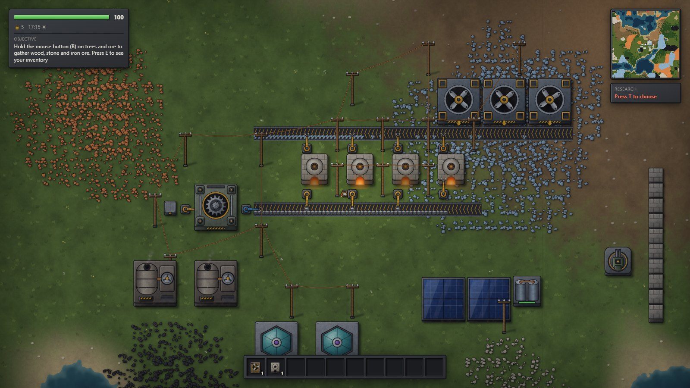
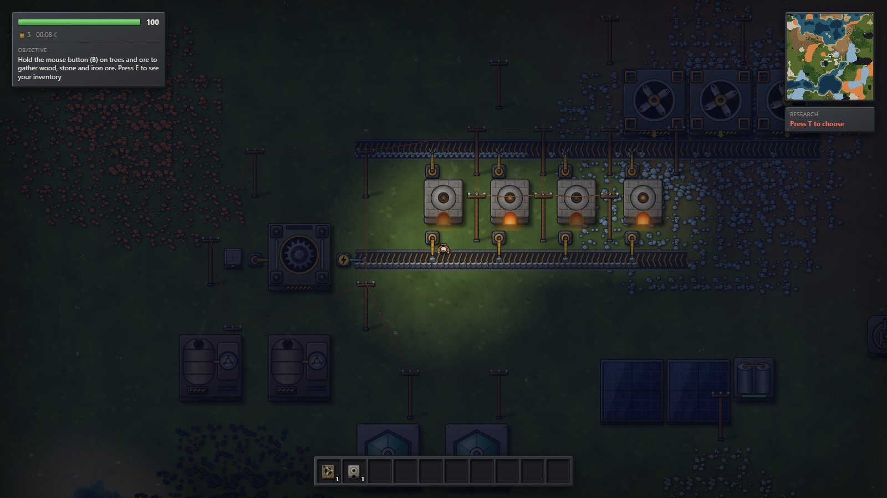
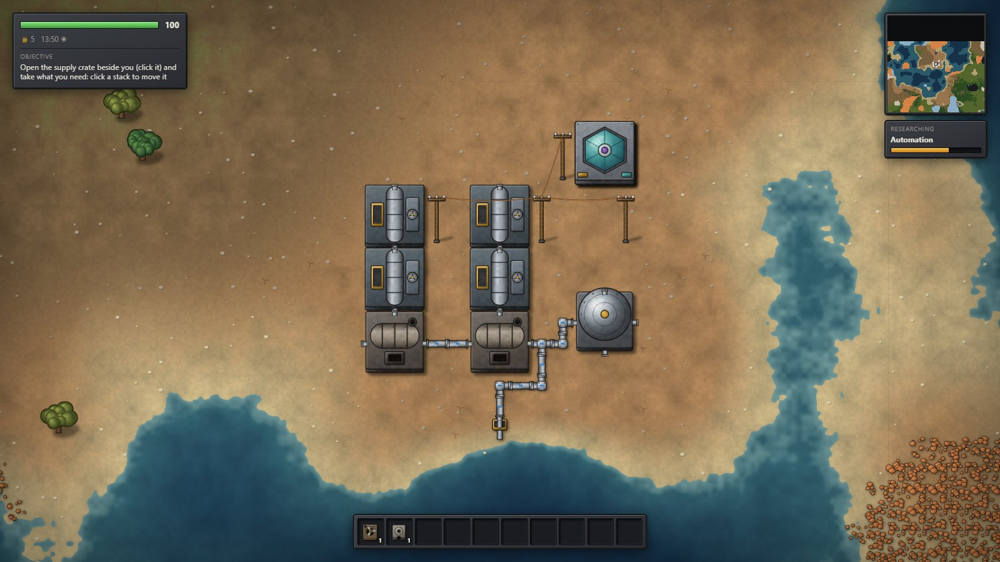
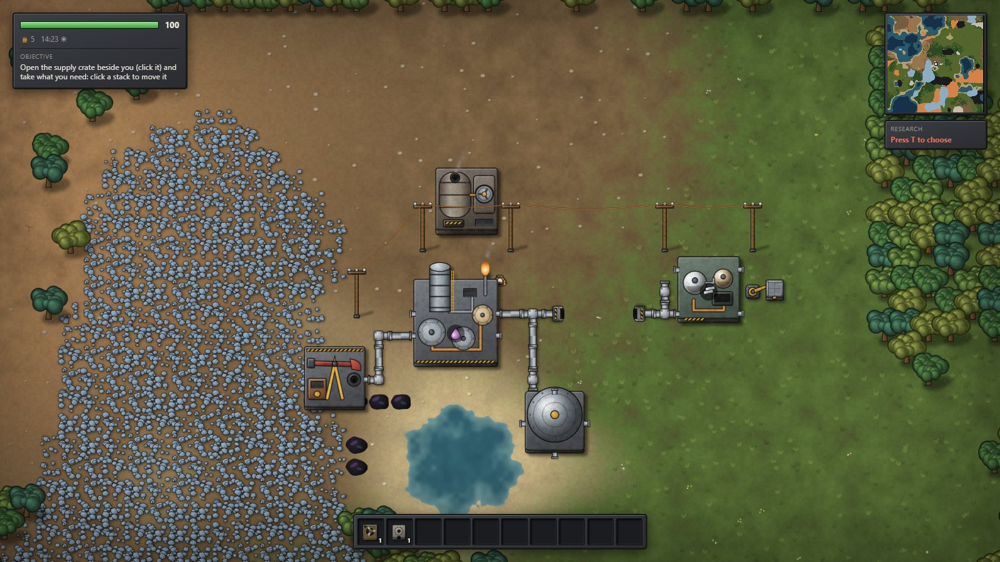
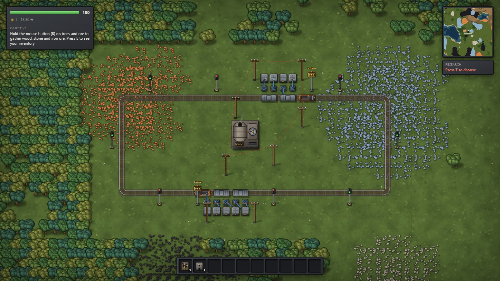
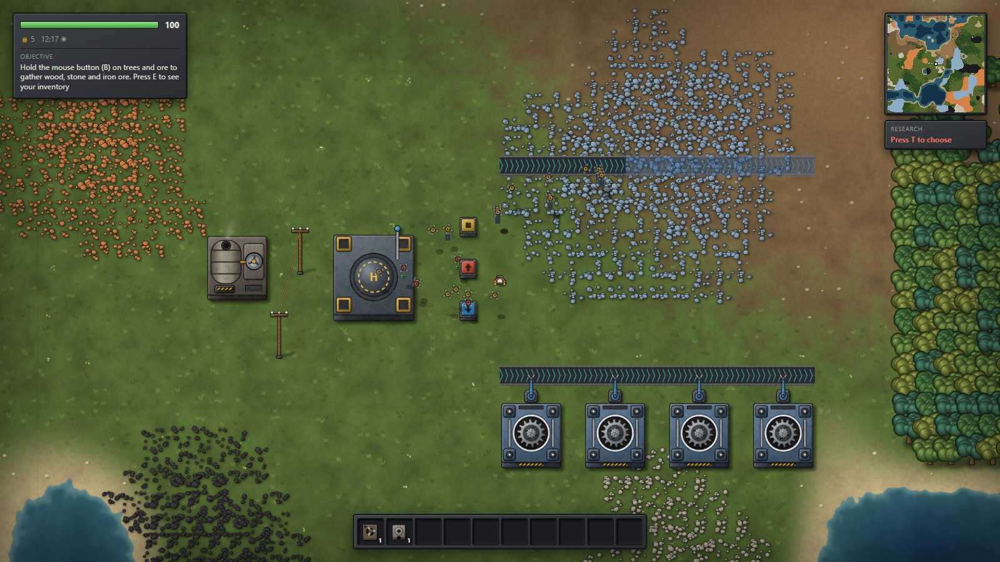
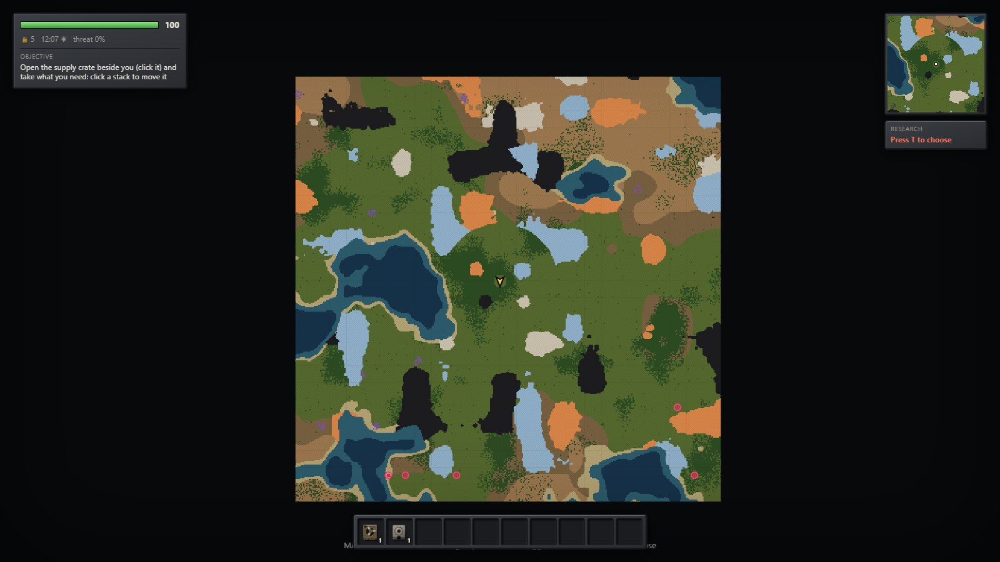
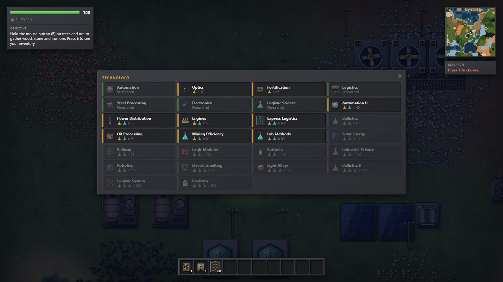
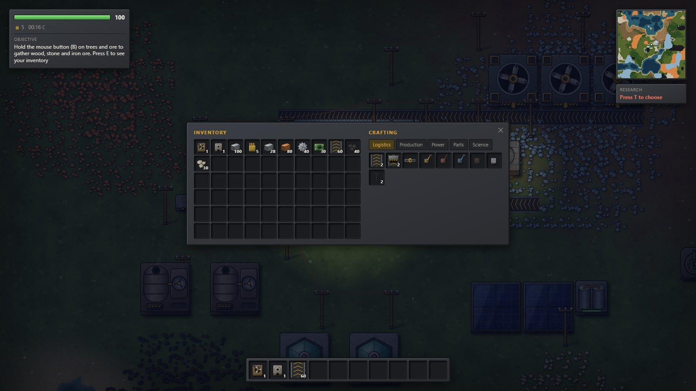

# Slagworks

[](https://github.com/billsargent/slagworks/actions/workflows/build.yml)

**A top-down factory automation game.** Land on an alien world, mine ore by hand, then build drills, furnaces, belts and assembly lines until the factory runs itself. Research your way through steam power, oil refining, trains and robots, fend off the local crawlers, and build a rocket to leave.

Every graphic, sound effect and piece of music is generated by code when the game starts. There isn't a single image or audio file in the project.

Runs on **Windows**, **Linux** and in any modern browser, including **Xbox** (Edge), with full controller support.



## Download

Grab the latest build from the [**Releases page**](https://github.com/billsargent/slagworks/releases/latest):

| Platform | File |
|---|---|
| Windows (installer) | `Slagworks-<version>-setup.exe`: adds Start menu and desktop shortcuts and an uninstaller |
| Windows (portable) | `Slagworks-<version>-portable.exe`: a single file, nothing to install |
| Linux | `Slagworks-<version>.AppImage` (make it executable and run it) or the `.tar.gz` |
| Browser / Xbox | `slagworks-<version>-web.zip`: host the files anywhere; see [docs/XBOX.md](docs/XBOX.md) |

The Windows builds aren't code-signed, so Windows SmartScreen may warn you the first time. Choose **More info → Run anyway**.

## Screenshots

| | |
|---|---|
|  **Day and night.** Furnaces, lamps and your own light glow after dark. |  **Steam power.** Pump water, boil it, and drive steam engines. |
|  **Oil processing.** Crude oil to petroleum gas to plastic, all through pipes. |  **Trains.** Schedules, stops, cargo wagons and block signals. |
|  **Robots.** Construction robots build your blueprints; logistic robots move items. |  **The map.** An endless, seeded world with adjustable resource spacing. |
|  **Research.** 27 technologies across three science packs. |  **Crafting.** Hand-craft anything; missing parts are crafted for you. |

## Features

- **Factory:** two-lane belts with curves and side-loading, underground belts, splitters, three kinds of robotic arm (with item filters), drills, furnaces, assemblers, chests with fill limits, labs and a 27-technology research tree.
- **Fluids and power:** pipes, underground pipes, storage tanks, offshore pumps, boilers and steam engines, burner generators, solar panels, accumulators and power poles.
- **Oil:** pumpjacks pipe crude oil to refineries for petroleum gas; chemical plants turn that into plastic and fuel blocks.
- **Trains:** rails that bend to join the track you're building, train stops, locomotives and cargo wagons, and schedules that wait until wagons are full, empty, idle or a set time has passed. Rail signals split track into blocks so several trains can share it, and make one-way track.
- **Robots:** roboports, construction robots that build blueprint ghosts and remove marked buildings, and logistic robots that fill requester chests from provider and storage chests.
- **Planning tools:** a full-screen map, blueprints with a library shared by all your saves (and copy-as-text to share them), copy and paste of machine settings, production statistics and a power graph.
- **World:** endless seeded terrain with lakes, forests, deserts and four ores plus oil, a day/night cycle with dynamic lighting, and trees that grow back. Choose how spread out resources are when you start a new game.
- **Enemies:** crawler nests that grow stronger over time and spread, attack waves, acid-spitting spitters, gun turrets and walls. There's also a peaceful mode with no attacks.
- **Comfort:** named save slots with autosave, a supply crate at the landing site, a step-by-step objective tracker, generated ambient music, and a settings window with key rebinding, interface size and fullscreen.

## Getting started

1. Open the **supply crate** next to you and take what's inside.
2. Walk up to a tree or an ore patch and **hold the mouse button** on it to gather wood, stone and ore. Press **E** to see your inventory and crafting menu.
3. Place a **burner drill** on iron ore and click it while holding coal or wood to fuel it. Put a **stone furnace** where its arrow points, and iron plates start appearing.
4. Build a **burner generator** with **power poles**, then a **research lab**. Press **T** to choose your first technology.
5. Follow the **objective** in the top-left corner. It walks you from your first drill all the way to the rocket.

## Controls

| | Keyboard / mouse | Controller |
|---|---|---|
| Move | W A S D | Left stick |
| Cursor | Mouse | Right stick |
| Build / use / open | Left click | A |
| Mine / remove (hold) | Right click | B |
| Inventory and crafting | E | X |
| Technology | T | Y |
| Rotate | R | D-pad right |
| Pick item under cursor / clear hand | Q | D-pad left |
| Map | M | Left stick click |
| Blueprints | B (Ctrl+C copy area, Ctrl+V paste) | D-pad down |
| Mark for removal by robots | Ctrl+X, then drag | Blueprint window |
| Copy / paste machine settings | Shift+right / Shift+left click | Machine window buttons |
| Production statistics | P | Pause menu |
| Hotbar | 1 – 0 | LB / RB |
| Zoom | Mouse wheel | LT / RT |
| Menu | Esc | Menu |
| Quick save / load | F5 / F9 | via menu |

Keyboard keys can be changed under **Settings**.

## Building from source

You need [Node.js](https://nodejs.org) 20 or newer.

Play in the browser (no install needed beyond Node):

```
npm run serve
```

then open http://localhost:5173 in Chrome or Edge.

Desktop builds:

```
npm install
npm start            # run in a window (F11 toggles fullscreen)
npm run dist:win     # Windows installer and portable exe in dist/
npm run dist:linux   # Linux AppImage and tar.gz in dist/ (run on Linux)
```

### Releases

GitHub Actions checks the code and builds Windows, Linux and the web version on every push. The files are under the run's **Artifacts**. To publish a release, push a version tag:

```
git tag v0.2.0
git push origin v0.2.0
```

The workflow uses the tag as the version number and attaches all the builds to a new GitHub Release.

## Project layout

| Path | What's in it |
|---|---|
| `src/data.js` | Items, recipes, buildings and technologies |
| `src/world.js` | World generation, placing and removing buildings, ghosts |
| `src/sim.js` | Belts, arms, machines, power, research, enemies, statistics |
| `src/fluids.js`, `src/trains.js`, `src/robots.js` | Pipe networks, railways and signals, roboports and robots |
| `src/blueprint.js`, `src/mapview.js` | Blueprints and settings copy, the full-screen map |
| `src/sprites.js`, `src/terrain.js` | Procedural art for buildings, items, creatures and ground |
| `src/audio.js` | Generated sound effects and music |
| `src/render.js`, `src/ui.js` | Renderer, HUD and windows |
| `src/input.js`, `src/settings.js` | Keyboard, mouse, gamepad and key bindings |
| `desktop/` | Electron wrapper for the Windows and Linux builds |
| `sw.js`, `manifest.webmanifest` | Installable web app (offline play, Xbox) |

See [PLAN.md](PLAN.md) for the original design notes.
